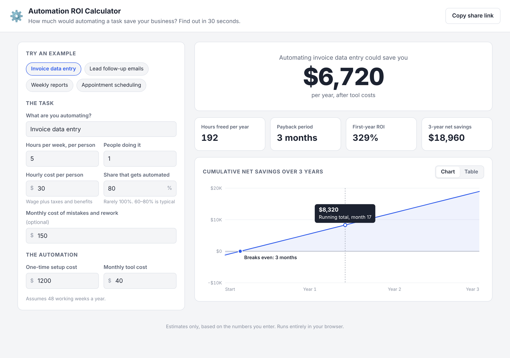

# ⚙️ Automation ROI Calculator

**How much would automating a task save your business?** Enter a few numbers and see your yearly savings, payback period and ROI instantly, with a 3-year chart.

Built for small business owners deciding whether a tool, a Zap or a custom automation is worth paying for. It's plain HTML, CSS and JavaScript, with no frameworks and no build step, and it runs entirely in the browser.



**▶ Live demo:** https://enrichado-ai.github.io/automation-roi-calculator/

---

## Features

- **Instant results.** Yearly savings, hours freed, payback period, first-year ROI and 3-year net savings update as you type.
- **3-year chart.** Shows cumulative net savings by month, with a break-even marker and a hover tooltip, plus a **table view** of each year.
- **Realistic inputs.** Covers the share of the task that actually gets automated, optional savings from fewer mistakes, the one-time setup cost and the monthly tool cost.
- **One-click examples.** Invoice data entry, lead follow-up emails, weekly reports and appointment scheduling.
- **Shareable links.** "Copy share link" saves every input in the URL, so you can send a prospect their own numbers.
- **Built-in call to action.** Add your booking link and a "Book a free call" box appears under the results (see below).
- **Mobile friendly, dark mode, no tracking.**

## Use it as a lead magnet

Open `app.js` and edit the `CONFIG` block at the top:

```js
var CONFIG = {
  ctaTitle: "Want help automating this?",
  ctaText: "Book a free 20-minute call and we'll map out what to automate first.",
  ctaButton: "Book a free call",
  ctaUrl: "https://calendly.com/your-name/intro",   // <- your booking page
  currency: "USD",
};
```

Leave `ctaUrl` empty to hide the box. Then link to the calculator from your website, emails or social posts. A visitor who sees "$13,512 a year" is a warm lead.

## How it's calculated

| Value | Formula |
|---|---|
| Hours freed per year | `hours per week × people × 48 weeks × % automated` |
| Labor savings | `hours freed × hourly cost` |
| Error savings | `monthly cost of mistakes × 12 × % automated` |
| Yearly net savings | `labor + error savings − monthly tool cost × 12` |
| Payback period | `setup cost ÷ monthly net savings` |
| First-year ROI | `(yearly net − setup) ÷ (setup + yearly tool cost)` |
| 3-year net | `yearly net × 3 − setup` |

All the math lives in [`roi.js`](roi.js), with no DOM code, and is covered by unit tests.

## Run locally

No install needed. Download the repo and open `index.html` in a browser.

```bash
git clone https://github.com/enrichado-ai/automation-roi-calculator.git
cd automation-roi-calculator
open index.html     # Windows: start index.html, Linux: xdg-open index.html
```

## Tests

Requires Node.js 18 or newer, with no dependencies.

```bash
npm test
```

GitHub Actions runs the tests on every push and deploys `main` to GitHub Pages.

## Project structure

```
├── index.html          # Layout: inputs, results, chart
├── styles.css          # Styles, responsive layout, dark mode
├── app.js              # UI: presets, chart, share links, CTA config
├── roi.js              # Pure ROI math
├── tests/roi.test.js   # Unit tests (Node's built-in runner)
└── .github/workflows/  # Tests + GitHub Pages deploy
```

## Roadmap

- [ ] Compare two automation options side by side
- [ ] Download results as a one-page PDF
- [ ] Optional email capture form before showing the full breakdown
- [ ] More currencies and a working-weeks setting

## License

[MIT](LICENSE). Free to use and adapt, including for client work.
